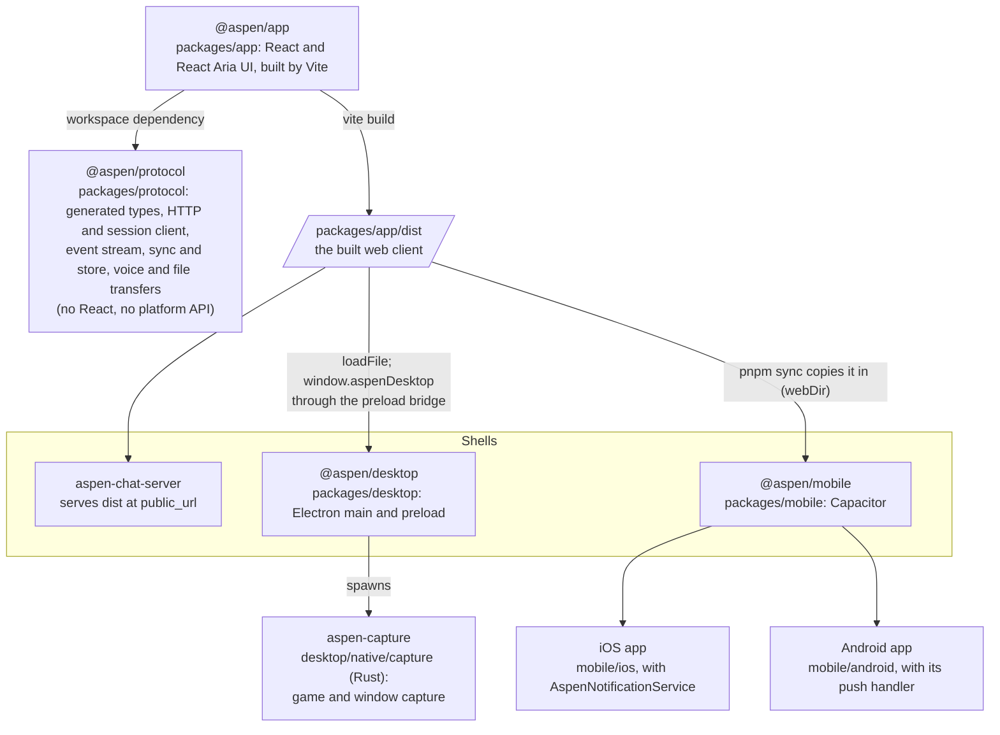
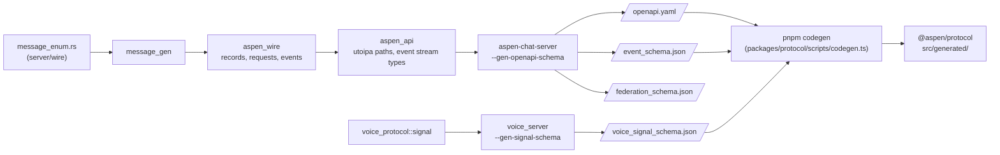

# Client packages

`client/` is a pnpm workspace: one TypeScript web app, shipped to browsers as it is, to desktops
inside Electron, and to phones inside Capacitor. `client/AGENTS.md` holds the rules that keep the
packages apart.

## Packages and shells

- `@aspen/app` is the only package that depends on another; the shells import nothing from it and
  carry its build instead, so the page is the same everywhere. What it needs of a host goes through
  the desktop's preload bridge (`window.aspenDesktop`) or Capacitor's plugins, never a Node or
  Electron API. See [Web client](../architecture/web-client/index.md) for how the server serves it.
- `@aspen/protocol` stays free of React and platform APIs so it can be tested in Node and used by
  any shell.
- The iOS notification service extension and Android's handler decrypt Web Push themselves, while
  the app is not running. See [Push](../architecture/push.md) and
  `client/docs/architecture/push.md`.

## Schemas join the server and the client

The client never declares a server type by hand. Each server writes the schemas of what it sends
and accepts, and `pnpm codegen` turns them into `@aspen/protocol`'s generated types, so a change on
the server surfaces as a compile error in the client.

- The four files are written to the repository root and are gitignored; `pnpm codegen:regen`
  regenerates them from the servers before generating.
- `openapi.yaml` becomes the types the openapi-fetch client is typed with; `event_schema.json` is
  copied verbatim for the event stream's runtime validator; `voice_signal_schema.json` types the
  voice server's signalling frames.
- `federation_schema.json` describes what deployments exchange with each other, which no client
  reads (see [Federation](../architecture/federation/index.md)).
