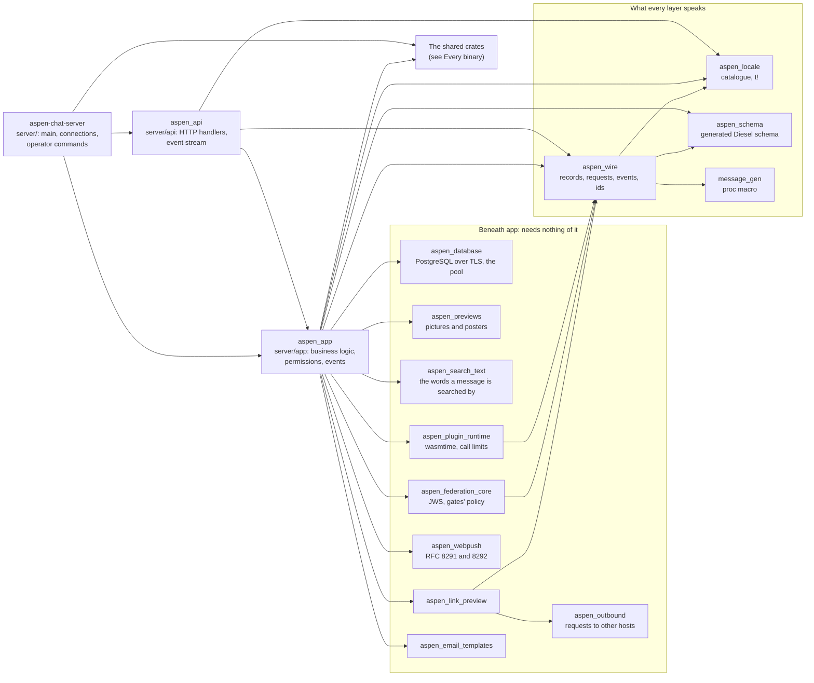
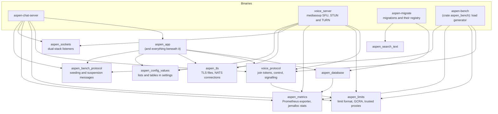
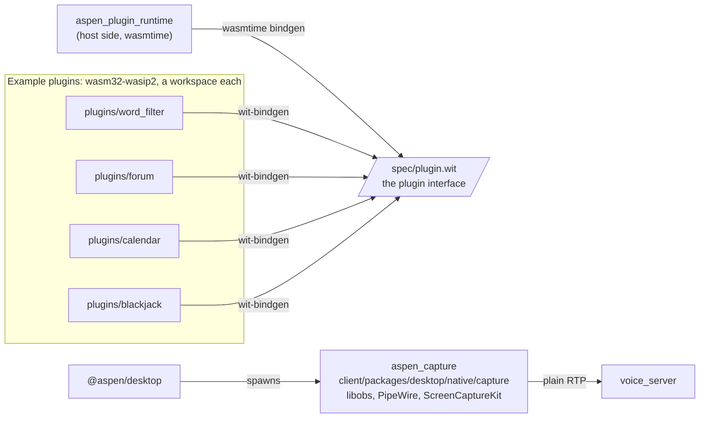

# Rust crates

The root `Cargo.toml` is one workspace of every server-side crate. Each arrow below is a dependency
in a crate's `Cargo.toml`, pointing from the crate that depends to the crate it depends on.

## The API server

`aspen-chat-server` is split into three layers, `api` over `app` over `schema`, with crates beneath
`app` that need nothing of it (see Layers in `AGENTS.md`). `api` never reaches past `app` into the
database; `app` never depends on `api`.

- The binary also names `aspen_schema` and `aspen_wire` itself, for its operator commands; those
  edges are left out to keep the layers readable.
- Which shared crate each of these uses is drawn in [Every binary](#every-binary). Besides the
  binary and `app`, `api` uses `aspen_limits` and `aspen_metrics`, and `aspen_database` uses
  `aspen_metrics`.
- `message_gen` turns the one enum in `server/wire/src/message_enum.rs` into each entity's record,
  request bodies, and server events, so `aspen_wire` is where the server and its clients agree.
- `aspen_wire` names `aspen_schema` for the SQL traits of the types it stores (`wire_name_traits!`
  and the rest), which is why the schema sits beneath it rather than only beneath `app`.
- The crates beneath `app` are re-exported from the `app` module that uses each one
  (`app::database`, `app::push::webpush`, `app::federation::jws`), so a path through `app` names it
  wherever it lives.

## Every binary

Four binaries come out of the workspace. The crates they share are the protocol between the API
server and the voice server, and the plumbing every server needs.

- `voice_protocol` is the whole contract between the two servers: the join token the API server
  signs and the voice server checks, the reports and commands they exchange over NATS, and the
  signalling frames clients exchange with the voice server.
- `aspen-migrate` needs the database connection, and `aspen_search_text` for the migration that
  found the words of every message written before `search_text` existed, at the version the server
  finds them with; its migrations are its own (`migrate/src/migrations/`), and `aspen_schema` is
  regenerated from the database they make.
- `aspen-bench` drives a deployment through its public API and the voice servers, and reads both
  servers' metrics by the names `aspen_metrics` gives them. The population it plans is written into
  the database by `aspen-chat-server bench seed`; `aspen_bench_protocol` is the plan and the
  manifest the two exchange. See [Benchmarking](../architecture/benchmarking.md).

## Outside the workspace

Some Rust is built on its own, for another target or because it links what the servers must not
need.

- Plugins and the server share nothing but `spec/plugin.wit`; a plugin is a WebAssembly component
  the operator installs, and `aspen_plugin_runtime` runs it. See
  [Plugins](../architecture/plugins/index.md).
- `aspen_capture` is the desktop app's helper process for game and window capture, built by
  `pnpm build:native` in `client/packages/desktop`, since it links libobs. See
  [Client packages](client.md).
