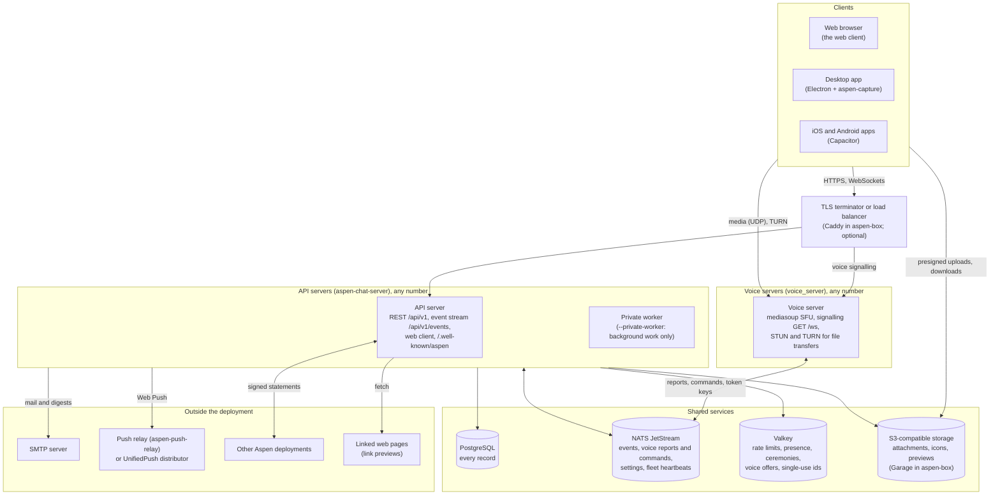
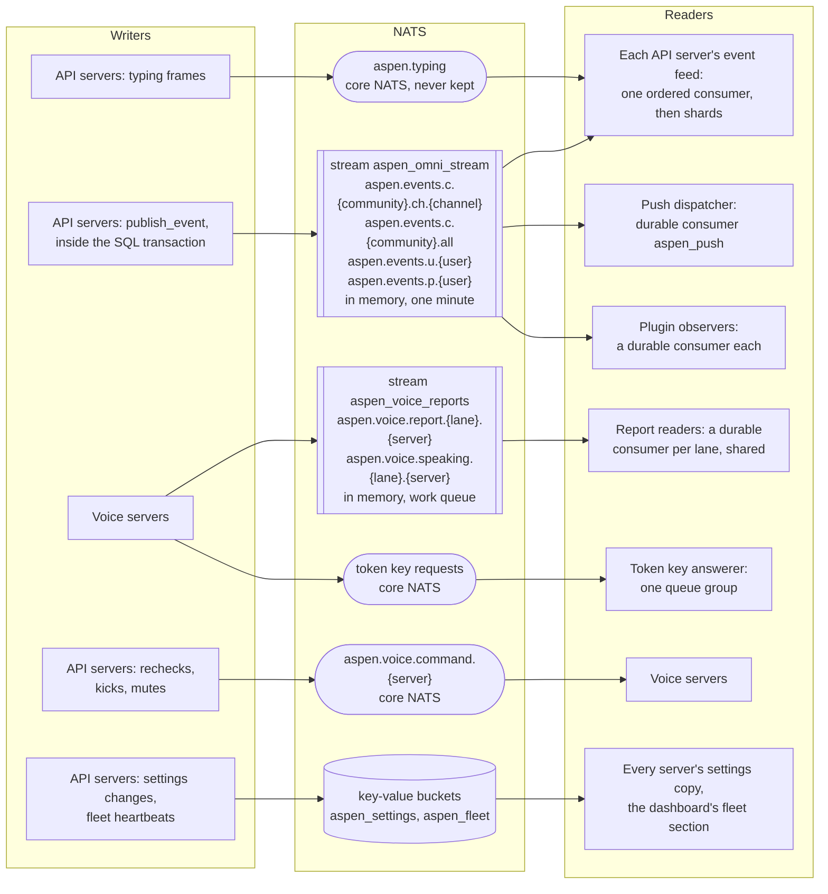
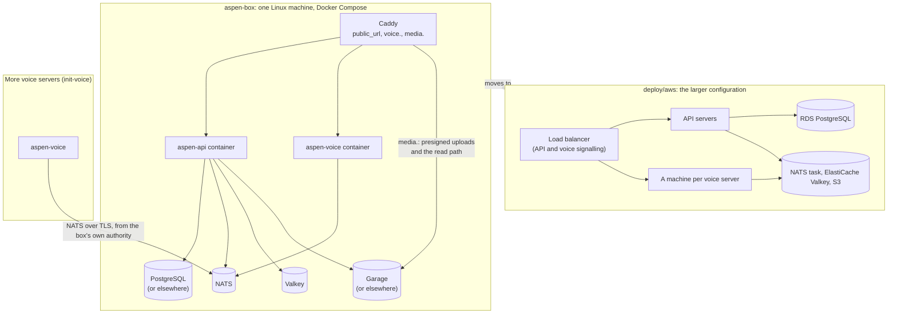

# The deployment

A deployment is one origin, `public_url`, served by any number of API servers, plus any number of
voice servers, sharing PostgreSQL, NATS JetStream, Valkey, and S3-compatible storage. The smallest
runs all of it on one machine (`deploy/box/`); a large one runs each part on machines of its own
(`deploy/aws/`). The shape is the same.

## Processes and services

- Every API server serves the same origin; any of them may answer any request, and each holds its
  own event stream connections. A private worker takes no requests and only shares the background
  work (mail, voice reports, standing checks, plugins' observers and timers, push). See
  [the web client](../architecture/web-client/index.md) and `app::context::Role`.
- Clients signal with a voice server over its own WebSocket (`GET /ws`, through the proxy where one
  terminates TLS) and send media straight to it. The API server offers them candidates and signs the
  token they join with; the voice server never reads the database. See
  [Voice](../architecture/voice/index.md).
- Clients upload attachments straight to storage with presigned URLs, and download them from
  `public_base_url`. The API server only signs, confirms, and makes previews (with `ffmpeg` and
  `ffprobe` as processes of their own for videos). See
  [Attachment previews](../architecture/attachment-previews/index.md).
- Phones are woken through their app's relay, which alone holds the Apple and Google credentials.
  See [Push](../architecture/push.md).
- Requests to other hosts (other deployments, link previews, push relays) go through
  `aspen_outbound`, which refuses private addresses unless the development settings allow them.

## What NATS carries

- Every change is published to `aspen_omni_stream` before its transaction commits, and committed
  only once JetStream acknowledges it, so the database and the stream agree on order. See Event
  Ordering Guarantee in `AGENTS.md` and [Event routing](../architecture/event-routing/index.md).
- Each API server reads the whole stream once and routes each event to the connections allowed to
  see it, through `event_feed_shards` routing tasks. A reconnecting client resumes from its last
  sequence while that is within the minute the stream keeps.
- Voice servers publish only on their own report subjects and are commanded on their own command
  subject; the stream is shared by every API server, one durable consumer per lane. See
  [Voice reports](../architecture/voice/voice-reports.md).
- `aspen_settings` holds the deployment settings each server keeps a copy of, and `aspen_fleet` each
  API server's heartbeat, which the dashboard's fleet section reads. How large the two in-memory
  streams may grow is in [NATS memory](../architecture/nats-memory.md).

## One machine and many

Both run the images `.github/workflows/images.yml` publishes (`ghcr.io/aspen-chat/aspen-api` and
`aspen-voice`) and write their configuration from `deploy/templates/`. A box that outgrows its
machine moves to the larger configuration with `deploy/aws/migrate.py`, which restores its database
from a dump and copies its files or hands over its bucket. See
[`deploy/README.md`](../../deploy/README.md).
