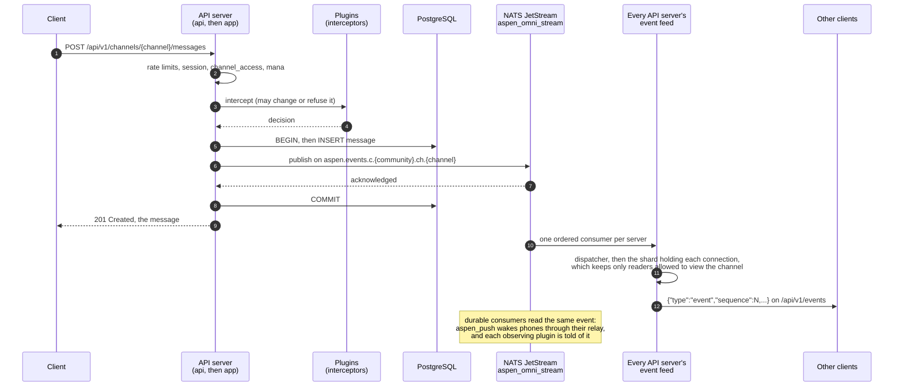
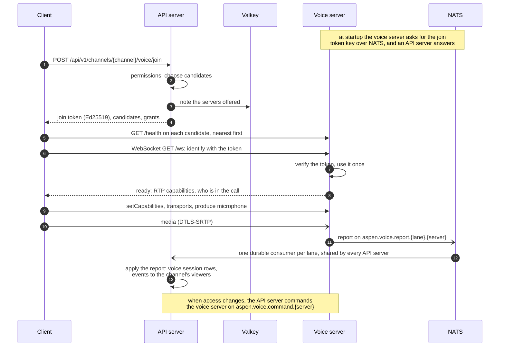
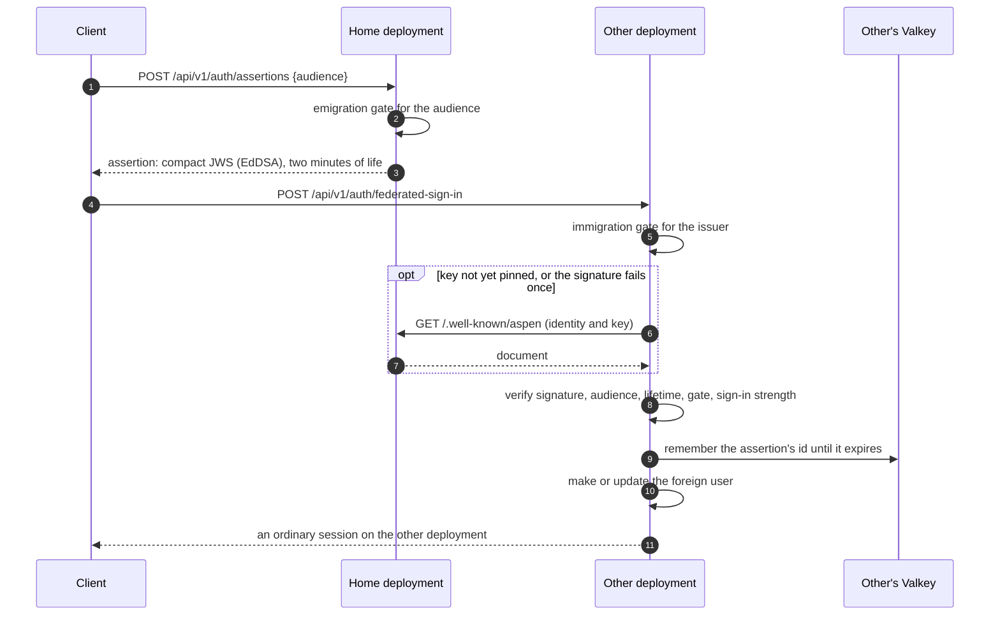

# Flows

What happens across the parts of a deployment for three things people do. Each is simplified to the
path that succeeds; the linked pages hold the rest.

## Posting a message

- The event is acknowledged before the transaction commits, so a refused publish rolls the message
  back and PostgreSQL and the stream never disagree on order. A rollback after publishing is
  answered with `communityResync` (see
  [Settling and resyncs](../architecture/event-routing/settling.md)).
- Plugins decide before the transaction opens, so a slow one holds no database connection.
- A message may instead be answered `202 Accepted` and held: in a busy channel, waiting its turn for
  the channel's mana (see [Channel mana](../architecture/channel-mana/index.md)), or while a preview
  of one of its attachments is made (see
  [Attachment previews](../architecture/attachment-previews/index.md)). It is posted later through
  the same transaction and event.

## Joining a call

- The voice server never sees the database or a session token; the join token and the grants in it
  are all it knows of the joiner, and rechecks keep the grants current. See
  [Join tokens](../architecture/voice/join-tokens.md) and
  [Rechecks and grants](../architecture/voice/rechecks.md).
- A report is believed only from the server its subject names, and only for a call or participant
  that server was offered for (the note in Valkey). See
  [Voice reports](../architecture/voice/voice-reports.md).

## Signing in to another deployment

- The client then holds a session on each deployment and talks to each directly; the deployments
  talk to each other only to verify and to send notices (DMs across deployments, standing checks,
  deletions). See [Signing in abroad](../architecture/federation/signing-in-abroad.md) and
  [Federation](../architecture/federation/index.md).
